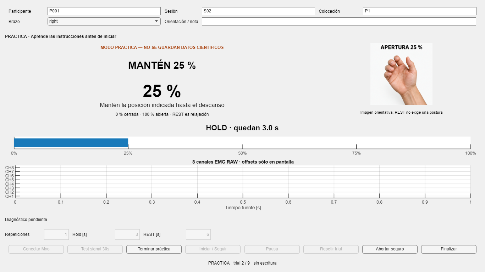

# Adquisición V1 — preparación de P001/S02

Trabajo local en `experiment/myo-continuous-calibration-dataset`, HEAD inicial `0f1d56c0fe1f08ad9ff9c63ca134c031b67a767a`. Ruta real encontrada: `C:\Users\Cesarbmm\ProtesisPracticas_myo_calibration`. No se cambió de rama, no se hizo commit/push, no se inició hardware ni entrenamiento.

## Auditoría del piloto S01

S01 es un **piloto fallido**, no un dataset científico válido. Sus 17 archivos se preservaron byte a byte, incluidos tres temporales: dos en recovery y uno de status. No se invocó recuperación sobre S01. Los hashes antes/después y la auditoría detallada permanecen locales bajo `.publication_local/acquisition_v1`, ignorada por Git; ningún RAW humano se copió ni se agregó al índice.

La evidencia persistida confirma:

- Fuente MYOMEX real, binario registrado disponible; el runtime actual resuelve MyoMex/MyoData/MEX en la instalación externa de Add-Ons.
- Precheck: 5.992 muestras EMG, ocho canales, 200 Hz por timestamps, datos finitos, tiempos monótonos, cero avisos; 1.503 muestras IMU a 50 Hz por timestamps (lectura directa verificada). Son tiempos reconstruidos por MyoData, no prueba de ausencia de pérdidas.
- Nueve filas del protocolo reducido, con PREPARE 2 s + transición 2 s + HOLD 3 s y REST 6 s.
- Trials 1–4 COMPLETED. Trial 5: ERROR_PARTIAL, protocol_index=5 y 220 muestras. Trials 6–7 REPEATED_PARTIAL y 8 ABORTED_PARTIAL, todos todavía en la fila 5.
- El snapshot temporal del trial 5 contiene el prefijo de 220 muestras que no llegó a reemplazar active_trial. El status final dice FINISHED, pero sigue en protocol_index=5: no representa protocolo completado.

El mensaje `No se puede quitar el archivo para ser reemplazado` / mscorlib fue proporcionado por el operador; su stack no quedó persistido en S01. La implementación previa llamaba a System.IO.File.Replace y los temporales son coherentes con ese fallo de promoción. No se atribuye a un proceso concreto de antivirus/sincronización sin evidencia. El ensayo independiente de 998 muestras EMG y 247 IMU en 5 s fue informado por el operador; no hay un artefacto separado de ese ensayo dentro de S01 para verificar esos dos conteos exactos.

## Corrección de persistencia

`myoAtomicPromote` usa NIO en el mismo directorio/volumen: ATOMIC_MOVE + REPLACE_EXISTING para estado/metadata/recovery/manifest. El fallback sin ATOMIC_MOVE sólo se activa ante falta de soporte y emite un aviso. No se borra primero el destino. Los trials finales se promueven sin opción de reemplazo. La [API Java](https://docs.oracle.com/javase/8/docs/api/java/nio/file/Files.html#move-java.nio.file.Path-java.nio.file.Path-java.nio.file.CopyOption...-) establece que ATOMIC_MOVE ignora otras opciones y su comportamiento ante destino existente depende del proveedor; por eso se evita para la ruta de no sobrescritura.

Los errores potencialmente transitorios tienen seis intentos como máximo (esperas de 25, 50, 100, 200, 200 ms). Tras agotar intentos, o ante un error definitivo, se falla explícitamente con su causa y se preservan los archivos disponibles. Validación round-trip de trials intacta, validación round-trip añadida a recovery y hash SHA256 comprobado después de cada promoción. Un éxito consume su temporal; un fallo conserva evidencia, sin barrido automático de temporales antiguos.

La sesión conserva el error original aunque guardar el status también falle. El status nuevo incluye `last_error` y `protocol_complete`; Finalizar no borra estados ERROR/ABORTED. La GUI distingue cierre sin sesión, cierre parcial y protocolo completo. La atomicidad de nombre no es una garantía de persistencia ante pérdida eléctrica.

## GUI y contrato visual

Misma clase MyoContinuousAcquisitionApp, ventana maximizada con marco y controles de Windows; cierre seguro conservado. Acción, porcentaje, guía, fase/cuenta regresiva y progreso preceden al EMG de ocho canales. Los valores de configuración bloqueados reflejan el protocolo suministrado.

`myoParticipantInstruction` deriva cada instrucción de fase, dirección y extremos del target. `includeRamps=false` conserva matemáticamente la transición interna de HOLD. `buildMyoContinuousProtocol` y `myoProtocolTarget` están intactos.

Práctica / Demo recorre el estímulo sin crear MyoAcquisitionSession, conectar un Myo ni crear directorios/MAT. El banner permanece visible mientras está activa. Los assets se resuelven relativamente a acquisition/references; si faltan, no se leen o contradicen el sentido de cierre, se usa texto. REST pide relajar, no adoptar la postura ilustrada. El target nunca pasa a measured_aperture.

Se preservó byte a byte el MyoMexDataSource modificado previamente por el usuario: resolución con which(), PATH desde MYO_SDK_ROOT/MW_MINGW64_LOC y hashes de los archivos reales. Las seis imágenes existentes tampoco se modificaron. No se copiaron MEX/DLL/SDK al repositorio.

## Validación

**60/60 tests PASS en MATLAB R2023b: 34 anteriores + 26 nuevos; cero fallos/incompletos.** Incluyen lock exclusivo real de Windows, reintento/fallback deterministas, fallo definitivo y conservación de evidencia; práctica sin archivos, fases en apertura/cierre, estados, precheck, cierre sin sesión, assets presentes/ausentes, protocolo reducido y procedencia de MyoMex.

Después de los tests se ejecutaron ambos smokes explícitamente:

- Corto: 25 trials sintéticos y 1.720 muestras EMG, con precheck sintético de 30 s.
- Prolongado: 1.000 iteraciones con 3.000 promociones explícitas (JSON, MAT y CSV), más sesión mock de 526 s simulados, 2.104 ticks, 81 trials y 105.200 muestras. Contenidos finales válidos, hashes correctos, cero temporales huérfanos y sobrescritura de trials rechazada. Ningún fallback MAT/CSV fue necesario en este volumen; su ruta alternativa se probó por inyección.
- Inspección visual de captura y práctica PREPARE/RAMP/HOLD/REST, incluyendo 1366×768. Los parámetros bloqueados muestran la configuración real 1 repetición / HOLD 3 s / REST 6 s.

[Resultados por test](validation_v1/test_results.csv), [resumen y gates](validation_v1/summary.json), [integridad de S01/cambios locales](validation_v1/integrity.json), [hashes de código probado](validation_v1/implementation_hashes.csv). Sólo se guardan aquí métricas, hashes de implementación y capturas mock; los MAT sintéticos permanecen en results, ignorados por Git.



```text
ACQUISITION_V1_STABLE = YES
ATOMIC_SAVE_STRESS = PASS
GUI_INSTRUCTIONS_CLEAR = YES
PRACTICE_MODE = PASS
MOCK_SMOKE = PASS
TESTS = 60/60
READY_FOR_P001_S02 = YES
DATASET_GENERAL_READY = NOT_DECLARED
HUMAN_ACQUISITION_STARTED = NO
PUSH = NO
```

READY significa preparación para un segundo piloto físico manual bajo la configuración validada; no garantiza ausencia de cualquier fallo futuro de Windows/hardware ni convierte el mock en evidencia científica humana.

## Comando manual de P001/S02

En MATLAB Desktop, con el runtime físico ya instalado y sin otra instancia MyoMex abierta:

```matlab
cd('C:\Users\Cesarbmm\ProtesisPracticas_myo_calibration\EMG_Prosthesis_TD3\matlab_code');
addpath('acquisition');
p = buildMyoContinuousProtocol(repetitions=1,includeRamps=false,holdSeconds=3,restSeconds=6);
app = MyoContinuousAcquisitionApp(Protocol=p,ParticipantID="P001",SessionID="S02",PlacementID="P1");
```

Practicar primero; después Conectar Myo → Test signal 30s → revisar avisos → Iniciar / Seguir. El constructor no conecta ni crea S02. Si S02 ya existe, se rechaza la escritura: no se sobrescribe ni mezcla. P001/S01 permanece intacta. La preparación autoriza únicamente un segundo piloto de infraestructura, no declara DATASET_GENERAL_READY ni validación científica de apertura real.
