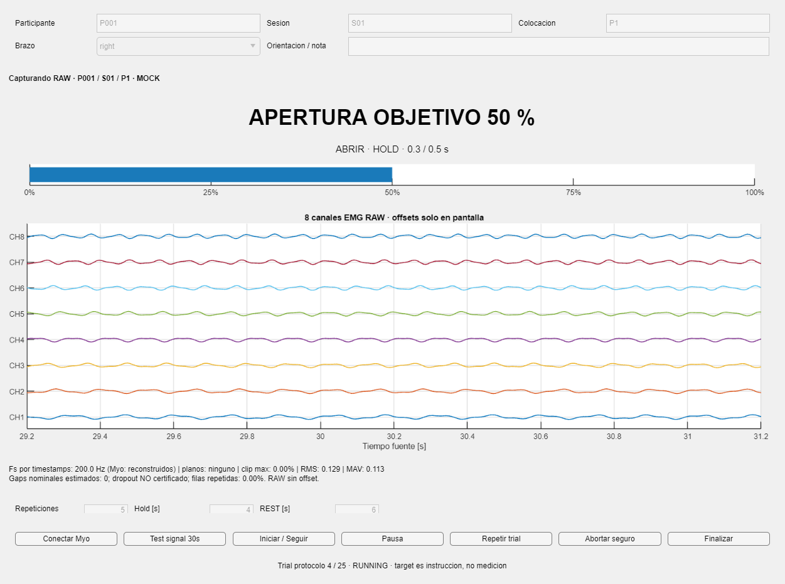

# Validación de la preparación

**34/34 pruebas de adquisición PASS**, sin Myo físico. Además se repitieron **12/12 pruebas del runner documental**, sin iniciar training. La publicación base ya había pasado 413/413 regresiones históricas en su archivo local autorizado; no se volvió a ejecutar el test sellado.

El smoke final completó 25 trials cortos del protocolo simulado, 1.720 muestras EMG de ocho canales, diagnóstico previo sintético de 30 segundos e IMU opcional. Se verificaron targets, preservación de RAW, etiquetas, guardado incremental, manifiesto, hashes y GUI. La suite cubre pausa, repetición, aborto, desconexión, prefijos recuperables, recuperación idempotente, rechazo de sobrescritura y separación target/medición. Los tiempos cortos del smoke no son la receta humana v1.

La imagen se inspeccionó: ocho canales visibles y paneles sin superposición. Las versiones intermedias de captura no se publican como evidencia final.

- [Resultados de las 34 pruebas](validation/test_results.csv).
- [Resumen del smoke final](validation/smoke_summary.json).
- [Hashes del código probado](validation/implementation_hashes.csv).
- [Estado de preparación y límites](validation/preparation_status.json).

Los MAT sintéticos completos quedan en la ruta local registrada en el resumen, fuera de Git. Se publican únicamente resumen, pruebas y una captura de GUI.

**Límite real pendiente:** el checkout no contiene `myo_mex.mexw64`, y algunas fuentes C++ históricas son contenedores Word. La API está auditada y el adaptador está preparado; no se afirma que una conexión física haya funcionado. El usuario debe proveer un MEX confiable y sus dependencias y ejecutar la primera prueba pequeña descrita en [la guía](MYO_GUI_USER_GUIDE.md). No se capturaron datos humanos ni se entrenó ningún modelo.

La rama parte de `c8e4d3132ea7299d0fadf2f8f19d29c3433539fa` en la publicación final. Código de planta, estados, reward, loaders históricos, MyoMex y runner científico E4 permanecen intactos. No se importó sandbox ni se consumieron datos crudos sellados.
