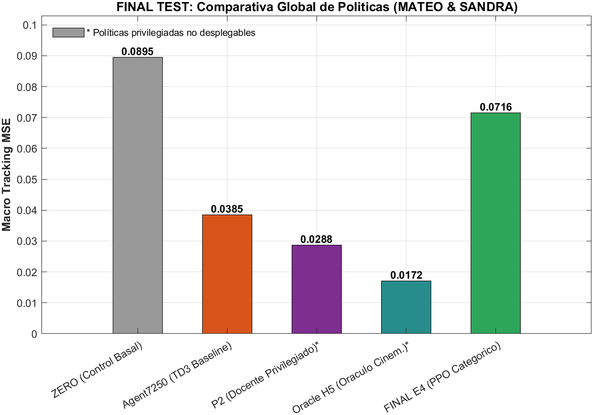

# Cierre canónico de la campaña paired-reference

Publicado el 12 de septiembre de 2026 a partir del archivo científico local. No se ejecutó nuevamente el test sellado para esta publicación.

**FINAL_SEALED_TEST_RESULT = FAIL**  
**NEW_DATA_ACQUISITION_REQUIRED = YES**

El PPO categórico corrigió importantes patologías de acción y produjo control mecánicamente más estable, pero el agente final E4 no generalizó suficientemente a los dos sujetos sellados bajo el pipeline EMG actual. Este resultado no demuestra que ninguna política feed-forward pueda generalizar, ni atribuye todo el fallo exclusivamente al domain shift.

## Alcance y secuencia de decisiones

La ejecución utiliza EMG/WMoos40 y estado mecánico en markov52. El guante histórico es teacher para reward y disponibilidad durante entrenamiento; no entra en observación, actor ni transición de planta. Se conserva Ts=.2, patternCurveCanonical y la referencia original. La referencia física continúa sin validación independiente. La vía EMG → guante virtual de E1–E1D permanece cerrada.

| Etapa | Resultado preservado y consecuencia |
|---|---|
| E2C | Caracterizó las dos órbitas P2 y las inversiones locales M3; no modificó la planta. |
| E2D | Deadband insuficiente: eliminar órbitas sacrificaba demasiado movimiento útil. |
| E2E | Reversal guard insuficiente. No se adoptó otra heurística. |
| E2F | Oracle H5 encontró una política privilegiada estable y mejor que P2. El bloqueo restante estaba relacionado con el soporte teacher/planta; no con imposibilidad general de control. |
| E2G | Contrato físico de referencia no validado. No se adoptó proyección ni alineación afín para training. |
| E3A-X | TD3 exploratorio, 20.000 episodios. BEST VALIDATION MSE .059980845; saturación y retrocesos M3, con empeoramiento posterior de validación. |
| CAP192 | MSE .060347570 y cero retrocesos M3, pero 70,68% de acciones en el nuevo límite; no justificó otro escalado continuo. |
| E3B | PPO multicategórico factorizado feed-forward, 4 heads × 15 categorías. CAT_LEARNING_SIGNAL. BEST 500k: VALIDATION MSE .057439; LAST 1M: .061475. Arquitectura nueva seleccionada para E4. |
| E3C | TEMPORAL_INFORMATION_NOT_DEMONSTRATED. No se reinterpretó la mejora secundaria closed-loop como PASS de imitación Oracle. |
| E3D | TEMPORAL_EMG_CONTEXT_NOT_SUPPORTED. La mejora de clasificación no satisfizo los gates de orden temporal y apertura. |
| E3E | Auditoría de dominio: firma individual EMG fuerte. NORMALIZATION_NOT_SUPPORTED; la normalización probada no resolvió la transferencia. |
| E3F | GRL redujo información de sujeto, pero también la información útil de intención. SUBJECT_INVARIANT_CONTROL_NOT_SUPPORTED; no sustituyó E3B. |
| E4 | Arquitectura E3B exacta, 10 sujetos DEVELOPMENT, seed 20260920, 500.000 pasos. Sin selección BEST: FINAL_AGENT fijado en 500k. |
| Test final sellado | MATEO/SANDRA abiertos una vez después de congelar agente y preregistro. Gates A/B/F fallaron; C/D/E pasaron. Campaña cerrada. |

Los documentos históricos conservan sus decisiones y autorizaciones tal como estaban al cerrar cada etapa. Las autorizaciones posteriores no convierten retrospectivamente un FAIL en PASS. E3E en esta campaña identifica la auditoría de dominio, no una campaña recurrente que nunca fue autorizada por E3D.

## Resultado final persistido

Macro-MSE del test sellado, 40 episodios entre dos sujetos:

| Política | MSE | Papel |
|---|---:|---|
| ZERO | 0.089539 | Basal pasivo |
| Agent7250 | 0.038495 | TD3 histórico congelado, ejecución EMG-only |
| P2 | 0.028763 | Privilegiado: consulta teacher actual |
| Oracle H5 | 0.017155 | Privilegiado: consulta teacher futuro |
| FINAL E4 | 0.071575 | PPO categórico, ejecución EMG-only |



La figura es un artefacto ya existente del test original; se incluye sin volver a evaluar sujetos. También se preserva el [desglose final por motor](../../EMG_Prosthesis_TD3/matlab_code/results/final_sealed_test/run_20260911_212959_985_f79338ed/figures/FINAL_TEST_BY_MOTOR.png).

E4 empeora el MSE de Agent7250 en **85,93%**. Por sujeto:

| Sujeto | Agent7250 | FINAL E4 | Cambio MSE |
|---|---:|---:|---:|
| MATEO | .030735 | .054789 | +78,26% |
| SANDRA | .046254 | .088361 | +91,03% |

E4 presenta cero ciclos, cero periodicidades y cero retrocesos M3. Agent7250 registra 76 eventos M3, tasa .1431 según el denominador histórico. La estabilidad por sí sola no compensa el tracking: FINAL_E4_MAX_CATEGORY_FRACTION=1.00, incompatible con el gate de diversidad de acción.

| Gate final | Resultado |
|---|---|
| A: MSE E4 menor que Agent7250 | FAIL |
| B: ningún sujeto empeora más de 10% | FAIL |
| C: cero ciclos | PASS |
| D: cero periodicidades | PASS |
| E: tasa M3 no superior a Agent7250 | PASS |
| F: máxima fracción de categoría <=.90 por motor | FAIL |

## Congelamiento y procedencia

```text
FINAL_AGENT = E4 step 500000
FINAL_AGENT_SHA256 = 2aa39fdf166c62fb6da057f1ddecb6455fbaa142f476718dd4e2725dfde08c90
REFERENCE_CONTRACT_VALIDATED = NO
HARDWARE_AUTHORIZED = NO
FINAL_SEALED_TEST_RESULT = FAIL
NEW_DATA_ACQUISITION_REQUIRED = YES
SEALED_TEST_REEXECUTED_FOR_PUBLICATION = NO
```

Ruta histórica del modelo, **no versionado en esta publicación**:

`C:\Users\Cesarbmm\ProtesisPracticas_e2b_audit\EMG_Prosthesis_TD3\matlab_code\results\e4_final_development\run_20260910_084228_108_8176e5a9\FINAL_AGENT.mat`.

Artefactos usados, sin volver a abrir EMG/glove crudos de MATEO/SANDRA:

- [Resumen sellado](../../EMG_Prosthesis_TD3/matlab_code/results/final_sealed_test/run_20260911_212959_985_f79338ed/FINAL_SEALED_TEST_SUMMARY.json).
- [Estado posterior](../../EMG_Prosthesis_TD3/matlab_code/results/final_sealed_test/run_20260911_212959_985_f79338ed/POST_TEST_STATUS.json).
- [Evidencia de apertura](../../EMG_Prosthesis_TD3/matlab_code/results/final_sealed_test/run_20260911_212959_985_f79338ed/UNBLINDING_EVIDENCE.txt): 2026-09-11 21:29:59.575, después del congelamiento.
- [Tabla de políticas](../../EMG_Prosthesis_TD3/matlab_code/results/final_sealed_test/run_20260911_212959_985_f79338ed/metrics/controller_summary.csv), tablas de dirección, motor y sujeto en la misma carpeta.
- [Resumen E4](../../EMG_Prosthesis_TD3/matlab_code/results/e4_final_development/run_20260910_084228_108_8176e5a9/E4_SCIENTIFIC_SUMMARY.json).

## Límites e implicación posterior

Sólo se evaluaron dos sujetos finales. Entre los posibles contribuyentes están firma individual EMG, sesión/colocación del Myo, representación WMoos, protocolo abrir/cerrar del dataset, ausencia de calibración del usuario y correspondencia teacher/planta. Esta campaña no identifica por separado todas esas contribuciones.

No corresponde ensayar otro algoritmo sobre este test ya consumido. La siguiente pregunta requiere datos nuevos y reutilizables: cuánta calibración EMG necesita un usuario nuevo para interpretar su intención. Una futura interfaz visual aporta intención instruida, no medición de apertura física; debe conservar RAW y distinguir target de measured.

Una corrida documental posterior de 1M pasos no sustituirá el agente final 500k, no generará otro resultado final y no reutilizará el test sellado.

## Publicación e integridad

La rama de publicación parte de `origin/experiment/no-glove-paired-reference-e3f` en `6998cf6fe145c0b9f35f52355d3d9eae4478643a` (E2B limpio). El worktree científico estaba en `c9582b6721b386c34c82e3124623f439893470cd`, cuya ascendencia incluye un commit sandbox. No se integró esa historia: copia selectiva registrada en [PUBLICATION_MANIFEST.csv](../../PUBLICATION_MANIFEST.csv), sin merge, cherry-pick ni push del HEAD científico.

No se añade sandbox_physics, datos originales, modelos grandes, buffers, logs temporales ni figuras individuales. Los datasets/recursos ya presentes en la base limpia no se vuelven a importar ni se modifican. Los archivos excluidos no se publican; `NOT_READ_EXCLUDED` en el manifiesto indica que sólo se inventariaron nombre/tamaño. El hash del modelo final se contrasta por el test de integridad, sin ejecutar la política.

Las regresiones se ejecutan desde el worktree de publicación con fixtures locales ignorados. Algunos tests históricos conservan rutas absolutas al archivo científico; se documenta esa dependencia en lugar de modificar sus comprobaciones para obtener PASS. [Resultados de regresión](../../EMG_Prosthesis_TD3/matlab_code/analysis/paired_reference/publication_results/summary.json).
